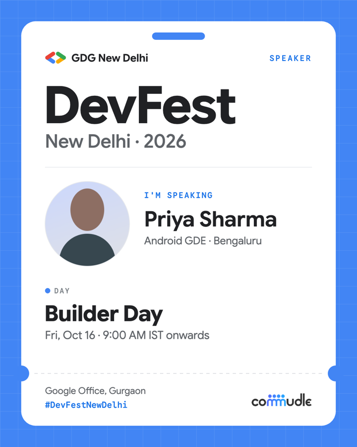
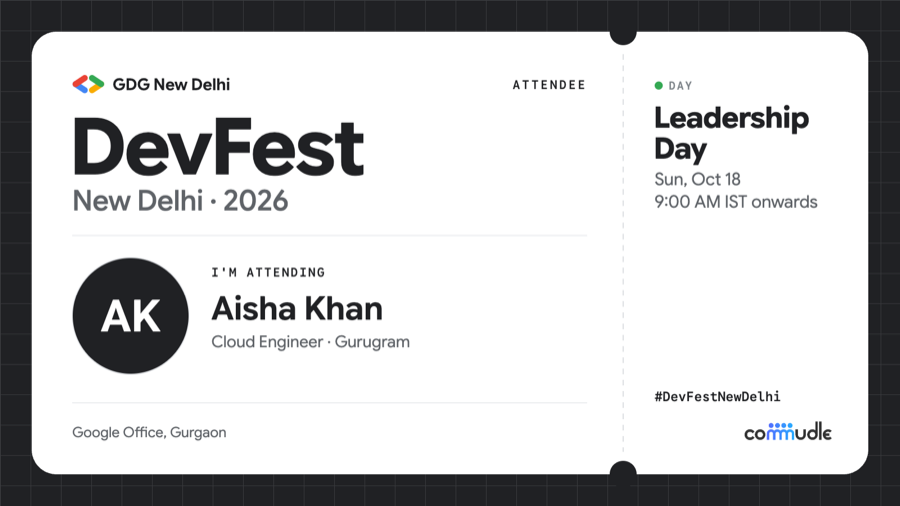

# DevFest New Delhi 2026 · Social Card Generator

Make a personalised **DevFest New Delhi 2026** card and share it on LinkedIn, Instagram or X.
Attendees, volunteers and speakers add their photo, name and the day they're coming, pick a colour and a
format, and download or post the card in one click.

Everything runs in the browser. Photos are never uploaded.


<p>
  
  
  
</p>

## Features

- **Three card types:** Attendee, Volunteer and Speaker, each with its own badge, line and caption.
- **Four formats:** LinkedIn post (1:1, 1200×1200), Instagram post (4:5, 1080×1350),
  X post (16:9, 1600×900) and Instagram/WhatsApp story (9:16, 1080×1920).
- **Live preview** that updates as you type. Long names shrink and wrap to fit; a missing photo becomes initials.
- **Five card colours** and a photo zoom slider.
- **Post buttons** for LinkedIn, X, Instagram and Story, with a ready-made caption that tags the right
  accounts on each platform.
- **Works on phones and desktop:** tested on 21 phone and tablet sizes (from a folded Galaxy Fold to iPad Pro)
  and 4 desktop sizes.

## How sharing works

| | On a phone | On a desktop |
|---|---|---|
| **LinkedIn / X** | Opens the share sheet with the image and caption attached | Opens the post editor with the caption filled in and the image copied, so you paste it with ⌘V / Ctrl+V. The image is also downloaded. |
| **Instagram** | Share sheet with the image attached | Opens instagram.com with the caption copied and the image downloaded, ready to upload |
| **Story** | Share sheet with the 9:16 image attached | Downloads the image; stories are posted from the apps |

Websites can't attach an image to a LinkedIn, X or Instagram post through a link, which is why desktop
uses the clipboard and download instead.

## Getting started

Requires Node.js 18 or newer.

```bash
npm install
npm run dev       # http://localhost:5173
npm run build     # production build in dist/
npm run preview   # serve the production build locally
```

To try it on your phone, run `npm run dev -- --host` and open the network address it prints
(phone and computer on the same Wi-Fi).

## Customising

All event details live in [`src/config.js`](src/config.js):

| Setting | What it controls |
|---|---|
| `passTypes` | Attendee / Volunteer / Speaker: badge, line above the name, caption wording |
| `days` | Day names, dates and colours |
| `time`, `venue` | Start time and venue shown on the card |
| `hashtag`, `hashtags` | Hashtag on the card and in captions |
| `mentions` | Accounts tagged in the caption for each platform |
| `themes` | Card colours |

**Logos.** The card draws the GDG bracket mark with "GDG New Delhi" next to it. To use the official
logo file instead, save it as `public/assets/gdg-new-delhi-logo.png` (transparent PNG). The Commudle
wordmark is `public/assets/commudle-logo.png`.

## Deploying

It's a static site. On Vercel or Netlify, import the repository and use:

- **Build command:** `npm run build`
- **Output directory:** `dist`

## Project structure

```
src/
  App.jsx        Form, live preview, download, share buttons and caption
  drawPass.js    Draws the card on a canvas in each format (layout, text fitting, photo crop)
  platforms.jsx  LinkedIn / X / Instagram / Story buttons: share links and icons
  config.js      Event details
  styles.css     Page styles
public/
  assets/        Logos used on the card
  favicon.svg    Browser tab icon
docs/            Screenshots for this README
```

Built with React and Vite for DevFest New Delhi 2026, organised by GDG New Delhi.
