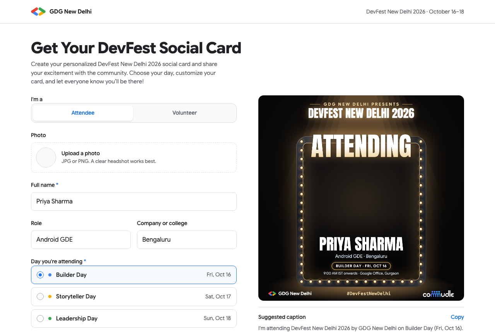
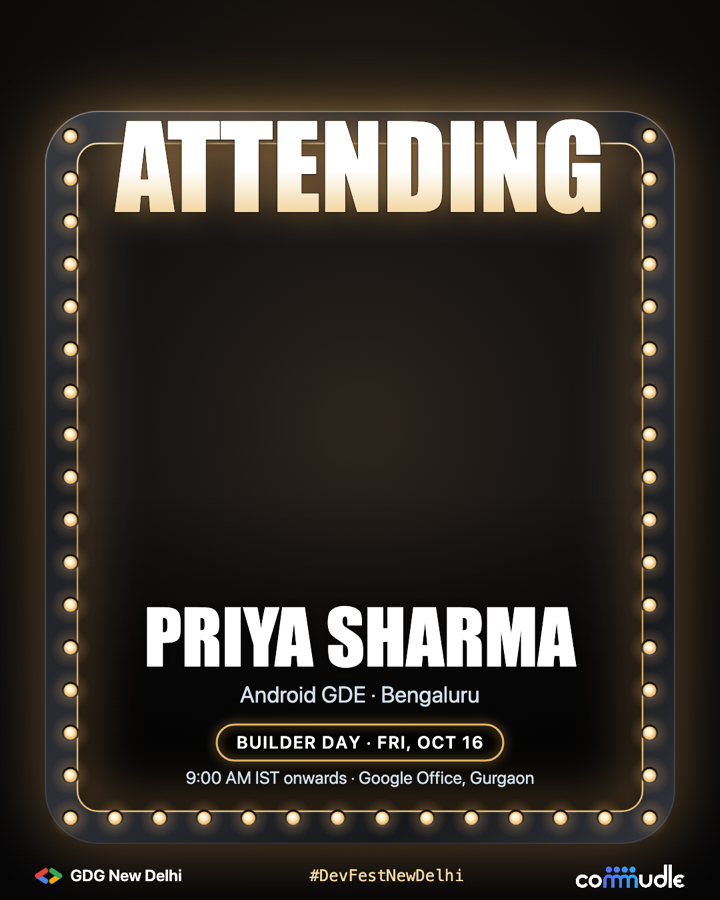
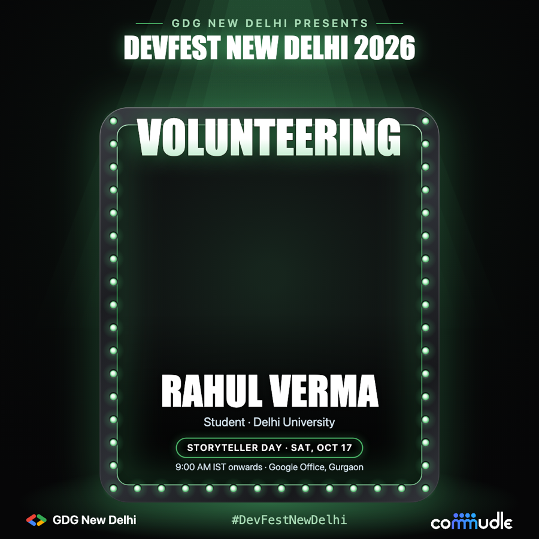
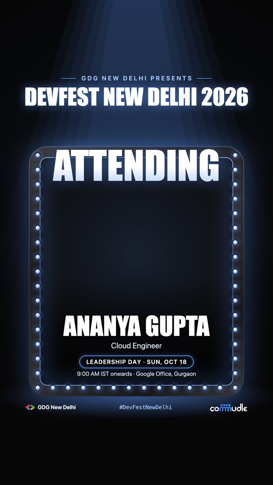
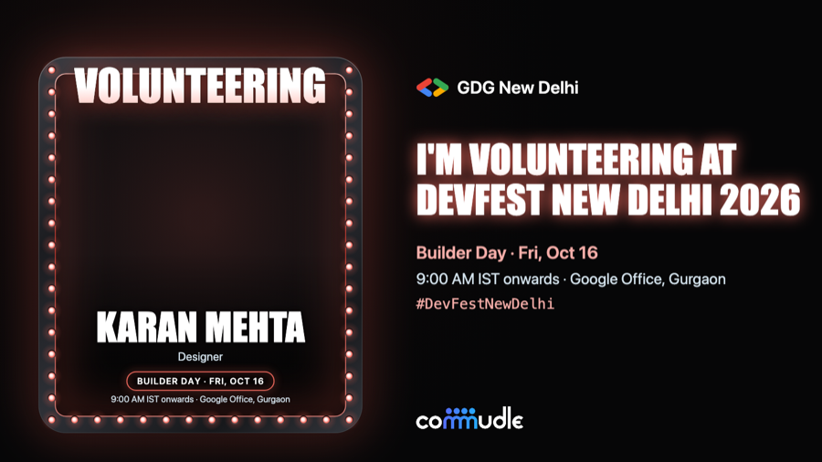

# DevFest New Delhi 2026 · Social Card Generator

Make a personalised **DevFest New Delhi 2026** card and share it on LinkedIn, Instagram or X.
Attendees and volunteers add their photo, name and the day they're coming, pick a frame colour and a
format, and download or post the card in one click. The card is a stage-lit marquee frame with their photo
inside and "ATTENDING" or "VOLUNTEERING" in lights across the top.

Everything runs in the browser. Photos are never uploaded; the person cut-out runs on the device too.



<p>
  
  
  
</p>
<p>
  
</p>

## Features

- **Two card types:** Attendee and Volunteer. The frame's headline ("ATTENDING" / "VOLUNTEERING") and the
  caption follow the type.
- **Marquee frame:** the photo sits inside a gunmetal frame lined with glowing bulbs, and the person is cut
  out automatically (Google MediaPipe, in the browser) so their head pops out in front of the headline. If no
  person is found, the photo simply sits behind the frame. There's a photo zoom slider too.
- **Six frame colours:** Gold (default), Blue, Red, Yellow, Green and Silver. The colour tints the bulbs,
  their glow, the line around the photo, the headline, the day pill and the hashtag.
- **Four formats**, each laid out for its platform:
  - **LinkedIn post** (1:1, 1200×1200) and **Instagram story** (9:16, 1080×1920): a "GDG New Delhi presents ·
    DevFest New Delhi 2026" header above the frame, with a spotlight and floor glow. The story keeps everything
    clear of the areas Instagram covers at the top and bottom.
  - **Instagram post** (4:5, 1080×1350): the frame on its own, with logos and the hashtag below.
  - **X post** (16:9, 1600×900): the frame on the left, event details on the right.
- **Live preview** that updates as you type. Long names shrink and wrap to fit.
- **Post buttons** for LinkedIn, X, Instagram and Story, with a ready-made caption that tags the right
  accounts on each platform.
- **Works on phones and desktop:** tested on 21 phone and tablet sizes (from a folded Galaxy Fold to iPad Pro)
  and 4 desktop sizes.

## How sharing works

| | On a phone | On a desktop |
|---|---|---|
| **LinkedIn / X** | Opens the share sheet with the image and caption attached | Opens the post editor with the caption filled in and the image copied, so you paste it with ⌘V / Ctrl+V. The image is also downloaded. |
| **Instagram** | Share sheet with the image attached | Opens instagram.com with the caption copied and the image downloaded, ready to upload |
| **Story** | Share sheet with the 9:16 image attached | Downloads the image; stories are posted from the apps |

Websites can't attach an image to a LinkedIn, X or Instagram post through a link, which is why desktop
uses the clipboard and download instead.

## Getting started

Requires Node.js 18 or newer.

```bash
npm install
npm run dev       # http://localhost:5173
npm run build     # production build in dist/
npm run preview   # serve the production build locally
```

To try it on your phone, run `npm run dev -- --host` and open the network address it prints
(phone and computer on the same Wi-Fi).

## Customising

All event details live in [`src/config.js`](src/config.js):

| Setting | What it controls |
|---|---|
| `passTypes` | Attendee / Volunteer: the frame headline, caption wording and day label |
| `days` | Day names, dates and colours |
| `time`, `venue` | Start time and venue shown on the card |
| `hashtag`, `hashtags` | Hashtag on the card and in captions |
| `mentions` | Accounts tagged in the caption for each platform |
| `frameColours` | Colours offered in the frame colour picker (bulbs, glow, hairline and accents); the first is the default |

**Frame and logos.** Everything on the card is drawn in code in [`src/drawPass.js`](src/drawPass.js), with no
artwork files: `drawFrame` (bezel and bulbs), `drawHeadline`, `drawEventHeader` and `drawStageLights` (the
LinkedIn and story header and spotlight). Bulb spacing (`BULB_GAP`) and frame width (`BEZEL`) are constants at the
top of the file. The Commudle wordmark is `public/assets/commudle-logo.png` and is made white automatically
for the dark card.

**Pop-out download.** The first time someone adds a photo, the browser downloads the MediaPipe engine (~3.5 MB,
from jsDelivr) and the selfie segmentation model (~250 KB, from Google). After that it's cached.

## Deploying

It's a static site. On Vercel or Netlify, import the repository and use:

- **Build command:** `npm run build`
- **Output directory:** `dist`

## Project structure

```
src/
  App.jsx        Form, live preview, download, share buttons and caption
  drawPass.js    Draws the card on a canvas in each format (frame, layout, text fitting, photo crop)
  cutout.js      Cuts the person out of the photo for the pop-out (MediaPipe, in the browser)
  platforms.jsx  LinkedIn / X / Instagram / Story buttons: share links and icons
  config.js      Event details, card types and frame colours
  styles.css     Page styles
public/
  assets/        Commudle logo used on the card
  favicon.svg    Browser tab icon
docs/            Screenshots for this README
```

## Licence

The code is released under the [MIT Licence](LICENSE).

The GDG, DevFest and Commudle names and logos belong to their owners and aren't covered by this licence.
If you reuse this for another event, replace them with your own branding in `src/config.js` and `public/assets/`.

---

Built with React and Vite for DevFest New Delhi 2026, organised by GDG New Delhi.
